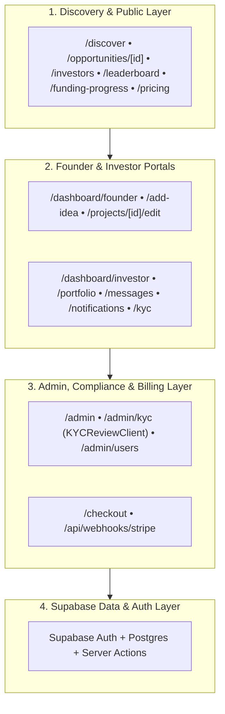

# Idea Business (`idea-business`) — Arabic Founder-Investor & KYC Platform

A full-stack Next.js and Supabase platform (`arabic-platform`) designed for MENA entrepreneurs and investors—featuring startup idea submission, KYC verification, funding progress analytics, direct messaging, and Stripe monetization.

---

## 1. Executive Summary & Purpose
`idea-business` provides the core digital infrastructure for an Arabic startup deal-flow and ideation network. Founders publish and refine project proposals (`/add-idea`, `/projects/[id]/edit`), investors discover vetted opportunities (`/discover`, `/opportunities/[id]`, `/investors`), and admins enforce compliance via `/admin/kyc`.

---

## 2. System Architecture & Layers



| Layer | Responsibility | Key Files |
| :--- | :--- | :--- |
| **Discovery & Showcase Layer** | Public startup directory, opportunity pages, leaderboards, and funding progress tracking | `app/{discover,opportunities,investors,leaderboard,funding-progress,portfolio,pricing}/page.tsx` |
| **Workspace & Comms Layer** | Dual Founder/Investor dashboards, profile pages, onboarding, messaging, and notifications | `app/dashboard/{founder,investor}/page.tsx`, `app/{messages,notifications,onboarding,profile/[id]}/page.tsx` |
| **Compliance & Admin Layer** | KYC verification queue and user administration | `app/kyc/page.tsx`, `app/admin/kyc/{actions.ts,KYCReviewClient.tsx,page.tsx}`, `app/admin/users/page.tsx` |
| **Payments & Webhooks Layer** | Checkout flows and Stripe webhook processing | `app/checkout/{page,actions,success}/`, `app/api/webhooks/stripe/route.ts` |

---

## 3. Core Functionality & Modules
- **Idea Submission & Editing**: Founders pitch projects (`/add-idea`) and iterate on details (`/projects/[id]/edit`).
- **Investor Discovery & Leaderboard**: Browse top-ranked ventures (`/leaderboard`, `/opportunities/[id]`).
- **KYC Verification**: Mandatory identity verification (`/kyc`) reviewed by admins (`/admin/kyc`).
- **On-Platform Messaging & Notifications**: Built-in communication between founders and investors.
- **Stripe Monetization**: Paid plans and checkout flows (`/pricing`, `/checkout`, `/api/webhooks/stripe`).

---

## 4. Project Structure
```text
├── app/
│   ├── add-idea/, discover/, opportunities/, investors/, leaderboard/
│   ├── admin/            # Overview, kyc review, users
│   ├── api/webhooks/stripe/
│   ├── checkout/, pricing/, funding-progress/
│   ├── dashboard/{founder,investor}/
│   ├── messages/, notifications/, kyc/, onboarding/, profile/[id]/
│   └── projects/[id]/edit/
├── components/, lib/, supabase/
└── AUDIT_REPORT.md, ADMIN_ACCESS_GUIDE.md, COMPLETION_SUMMARY.md
```

---

## 5. Getting Started

```bash
git clone https://github.com/islamsamyy/idea-business.git
cd idea-business
npm install
npm run dev
```

---

## 6. Business Value & Growth Opportunities
- **MENA Angel Network Enablement**: Streamlines deal sourcing and investor due diligence in Arabic-speaking markets.
- **Tiered Access & Deal Syndication**: Charge founders for verified pitch placement and investors for priority deal-flow access.
- **Consolidation Path**: Serves as the foundational codebase alongside `fakret-mashrou-final-`, ready to be extended with automated NDA signing and digital cap-table tracking.
