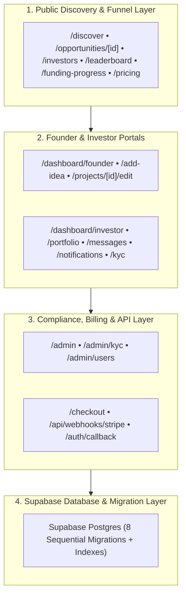

# Idea Business (`idea-business`) — Arabic Founder-Investor & KYC Platform

## Table of Contents
- [Executive Summary & Business Utility](#executive-summary--business-utility)
- [Visual Showcase (UI & Dashboards)](#visual-showcase-ui--dashboards)
- [System Architecture & Layers](#system-architecture--layers)
- [Data Model & Indexing](#data-model--indexing)
- [Database Schema, Migrations & RLS](#database-schema-migrations--rls)
- [Application Modules & API Endpoints](#application-modules--api-endpoints)
- [Getting Started & Scripts](#getting-started--scripts)
- [Business Value, ROI & Growth Opportunities](#business-value-roi--growth-opportunities)

---

## Executive Summary & Business Utility
`idea-business` (`arabic-platform`) is a full-stack Next.js and Supabase platform designed to connect Arab entrepreneurs with angel and seed investors. It provides dedicated workflows for idea submission (`/add-idea`), startup editing (`/projects/[id]/edit`), investor discovery (`/discover`, `/opportunities/[id]`, `/leaderboard`), identity verification (`/kyc`, `/admin/kyc`), on-platform messaging, and Stripe checkout.

---

## Visual Showcase (UI & Dashboards)
Key operational surfaces built with Next.js App Router & Tailwind CSS:
- **Founder Workspace**: `/dashboard/founder`, `/add-idea`, `/projects/[id]/edit`
- **Investor Deal Room**: `/dashboard/investor`, `/discover`, `/opportunities/[id]`, `/investors`, `/leaderboard`, `/funding-progress`
- **Admin & KYC**: `/admin`, `/admin/kyc` (`KYCReviewClient.tsx`), `/admin/users`

---

## System Architecture & Layers



| Layer | Responsibility | Key Files |
| :--- | :--- | :--- |
| **Discovery & Showcase** | Opportunity browsing, investor profiles, funding progress, and leaderboards | `app/{discover,opportunities,investors,leaderboard,funding-progress}/page.tsx` |
| **Role Dashboards & Comms** | Founder & investor dashboards, messaging, notifications, and profile pages | `app/dashboard/{founder,investor}/page.tsx`, `app/{messages,notifications,profile/[id]}/page.tsx` |
| **KYC & Admin Governance** | KYC submission and admin approval actions | `app/kyc/page.tsx`, `app/admin/kyc/{actions.ts,KYCReviewClient.tsx,page.tsx}` |
| **Billing & Persistence** | Stripe checkout/webhooks and 8 sequential Supabase SQL migrations | `app/checkout/*`, `app/api/webhooks/stripe/route.ts`, `supabase/migrations/20260417*.sql` |

---

## Data Model & Indexing
Defined across 8 structured migrations (`20260417000001_create_enums.sql` through `20260417000008_create_indexes.sql`) with dedicated query indexes for fast deal-flow filtering and messaging lookups.

---

## Database Schema, Migrations & RLS
| Table | Migration | Purpose |
| :--- | :--- | :--- |
| `profiles` | `000002_create_profiles.sql` | Founder, Investor, and Admin user profiles |
| `projects` | `000003_create_projects.sql` | Startup pitches, funding targets, and stages |
| `investments` | `000004_create_investments.sql` | Investor commitments linked to projects |
| `messages` | `000005_create_messages.sql` | Direct founder-investor communication |
| `saved_opportunities` | `000006_create_saved_opportunities.sql` | Investor deal bookmarks / watchlists |
| `notifications` | `000007_create_notifications.sql` | Real-time platform alerts |
| `contact_messages` | `supabase/migrations/` | Public inquiry submissions |

---

## Application Modules & API Endpoints
- **Routes**: `/add-idea`, `/projects/[id]/edit`, `/discover`, `/opportunities/[id]`, `/investors`, `/leaderboard`, `/funding-progress`, `/portfolio`, `/pricing`, `/checkout`, `/kyc`, `/onboarding`, `/messages`, `/notifications`, `/admin/kyc`, `/admin/users`
- **API Endpoints**:
  - `app/api/webhooks/stripe/route.ts` — Stripe payment webhook handler
  - `app/auth/callback/route.ts` — Supabase authentication callback

---

## Getting Started & Scripts

```bash
git clone https://github.com/islamsamyy/idea-business.git
cd idea-business
npm install
npm run dev
```

---

## Business Value, ROI & Growth Opportunities
- **Structured MENA Deal Flow**: Standardizes early-stage startup pitches and investor KYC in Arabic-first markets.
- **Monetization Channels**: Featured pitch upgrades via `/checkout`, investor pro memberships, and deal syndication fees.
- **Documentation Artifacts**: Includes `AUDIT_REPORT.md`, `ADMIN_ACCESS_GUIDE.md`, and `ENHANCEMENT_SUMMARY.md` for rapid engineering onboarding.
